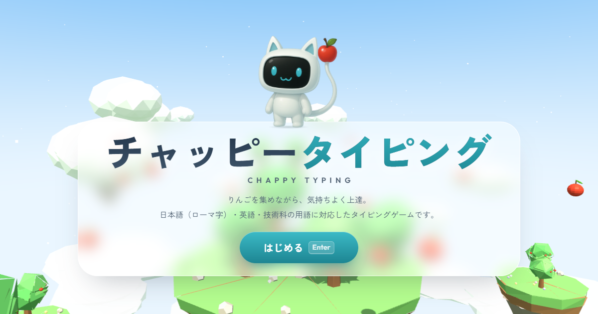

# チャッピータイピング

チャッピーと一緒にりんごを集めながら、タイピングが上達するブラウザゲームです。
日本語（ローマ字入力）・英語・中学校技術科の用語に対応しています。



## 遊び方

`index.html` をブラウザで開くだけで遊べます（インストールやサーバーは不要です）。
パソコンのキーボードで遊んでください（スマートフォンには対応していません）。

## モード

| モード | 内容 |
|---|---|
| 🍎 りんごラッシュ | 60秒でりんごを何個集められるか。ミスなしで続けるとコンボボーナス |
| 🔧 技術科ことば | 技術分野の用語（4分野・119語）で、りんごラッシュ。用語の意味も表示 |
| 📈 ステップ練習 | ホームポジションから文章まで、日本語17・英語13のレッスン。★3つで評価 |
| 🔍 にがて特訓 | 記録から苦手なキーを割り出して、集中的に練習 |
| 🎯 りんごキャノン | 落ちてくる言葉を打って撃ち落とす。ウェーブごとに速くなる |
| ⌨️ フリー計測 | 飾りなしで、30秒・60秒・2分の速さと正確さを測定 |

## 特長

- **ローマ字のいろいろな打ち方に対応**：shi / si、chi / ti、nn / n、xtu / ltu、子音の重ね打ちなど。よく使う打ち方には、ガイド表示が自動で合わせます
- **指ガイド**：次に押すキーと使う指を、画面のキーボードで表示します（日本語配列・英語配列）
- **3D の背景**：空に浮かぶ島とりんごの木（Three.js）。重いパソコンでは、自動で画質を下げます。設定でオフにもできます
- **効果音と BGM**：すべて Web Audio API でその場で作っています（音源ファイルなし）
- **記録**：自己ベスト、速さのグラフ、苦手マップ、実績（22種類）、連続日数。記録はこの端末のブラウザだけに保存し、ファイルへの書き出し・読み込みもできます
- **きせかえ**：りんごを集めると、チャッピーのアクセサリー（6種類）と背景の空（3種類）が解放されます
- **使いやすさ**：文字の大きさの切り替え、アニメーションを減らす設定（OS の設定にも自動で合わせます）、日本語入力がオンのときの注意表示

## ファイル構成

```
index.html
css/style.css        基本の見た目
css/features.css     各モード・記録・きせかえなどの見た目
js/typing.js         入力判定（ローマ字エンジン）
js/session.js        出題・成績の計算
js/modes/            各モード（rush = りんごラッシュ・技術科ことば / step / weak / cannon / free）
js/keyboard.js       画面のキーボード（指ガイド・苦手マップ）
js/scene3d.js        3D 背景
js/chappy.js         チャッピーの表示・動き・きせかえ
js/audio.js          効果音・BGM
js/storage.js        記録の保存
js/achievements.js   実績・きせかえの解放条件
js/main.js           画面の切り替え・演出・結果・記録・設定
data/                問題データ（日本語・英語・技術科ことば・レッスン）
assets/chappy/       チャッピーのパーツ画像
assets/og.png        共有用の画像
vendor/three.min.js  Three.js r149（MIT ライセンス）
```

## 公開（GitHub Pages）

1. このフォルダの中身をリポジトリに入れて push します
2. リポジトリの Settings → Pages で、ブランチのルート（`/`）を公開元に選びます

共有したときに画像が出るように、公開後は `index.html` の `og:image` を `https://（ユーザー名）.github.io/（リポジトリ名）/assets/og.png` のような完全な URL に書きかえてください。

## ライセンス

- Three.js：MIT License（© 2010-2023 Three.js Authors）
